 

<h1 align="center">Bach Trinh</h1>

Software Engineer · .NET · Cloud · Hanoi, Vietnam

<em>"There's always a way. I find it."</em>

 

<h2>👨🏻‍💻 About Me</h2>

- 💼 Currently working at **Optimizely, Inc.**
- 🔭 Specializing in **.NET Core** and backend development.
- ☁️ **AWS Certified Solutions Architect – Associate.**
- 🛠️ 3+ years of experience in building scalable backend systems.
- 🔗 Former **Builder for Cardano Catalyst.**

 
  

